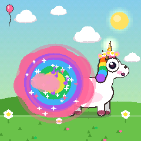
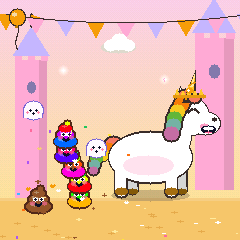
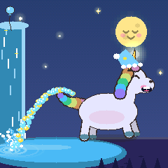
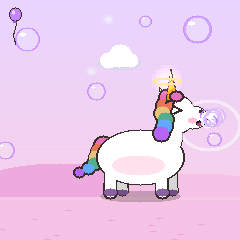
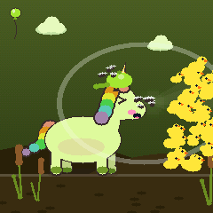
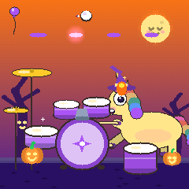
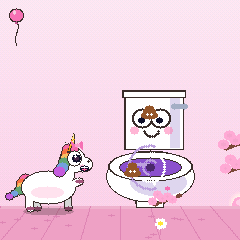
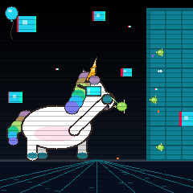
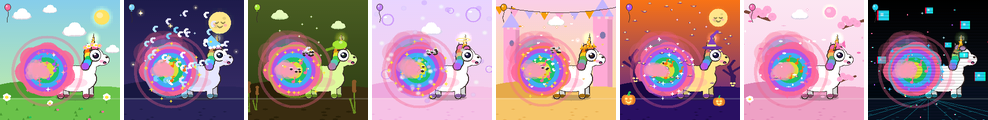

# Spooky Stable v2

A no-menu, no-text toy firmware for the **M-VAVE FM-1**, made for a 3-year-old who loves crazy animation, bodily
humour and friendly spooky things. Eight buttons each open a toy starring the rainbow unicorn; every one of the 27
keys makes the toy act at once, with sound, shake, particles and a squash-and-stretch cartoon. Every note snaps to
the mood's scale, so nothing she plays can sound wrong.

| | | | |
|---|---|---|---|
|  |  |  |  |
|  |  |  |  |



## The toys

| Button | Toy | Any key | K2 | K3 | K4 | K6 (ALGO) | K7 (PRESET) |
|---|---|---|---|---|---|---|---|
| **HOME** | Unicorn Fart | She braces, then a rainbow cloud bursts out (1 in 10 hides a winking skull); high keys squeak | duration 0.3–1.5 s | cloud size | pitch-bend depth | cloud style: rainbow / skull / glitter / slime | chaos: shake, particles, skulls |
| **EDIT** | Unicorn Poop | She strains and pops; a poop arcs onto the pile, each plop a step up the scale; every few the pile does a rainbow tower dance, every third a tiny ghost giggles away | drop rate while held, 1–12 a second | poop size | how far each plop climbs | classic / rainbow / glitter / slime | gravity and the pile's height before the dance |
| **LFO** | Unicorn Pee | Hold: a stream arcs into the pool while a flute sings; another key glides the flute there | pulse | arc height | glide range | sunny / rainbow / glitter / glow | splash chaos and puddle growth |
| **FX** | Unicorn Burp | A gulp, the belly swells, a held breath, then BURP with bubbles and an up-and-down rumble | duration | belly size | pitch | bubbles | echo and chaos |
| **ENV** | Unicorn Sneeze | Hold to breathe in (a bar rises at the left); let go: a silent beat, then CHOO, blowing everything in the cone off the screen | charge time 0.5–2 s | blast force | pitch | snot / rainbow / confetti / ducks | crunch, and a torn screen |
| **GLO** | Drum Jam | Left third drums, middle third cymbals, right third silly keys (boing, honk, slide whistle, "ow!") in the scale; all on a 16th-note grid | tempo 60–180 | swing 0–60 % | kit tuning | auto-drummer density | crunch and chaos |
| **ARP** | Toilet Flush | Something drops in and the toilet flushes: a whirlpool pulls in everything on the screen, each a bloop lower | flush speed | whirlpool size | gurgle pitch | poops / ducks / toilet rolls / rainbow fish | the water's colour and glow |
| **SEQ** | Booger Flick | Hold: hoof to nose, a glittery booger grows; let go: flick! It splats onto the wall (12 at most; the oldest slides off) | flick power | booger size | splat pitch | green / rainbow / glow / gold | how many the wall holds |

## Everywhere

| Control | What it does |
|---|---|
| **K1** | Volume, shown as 10 dots. Never above 70 % of full scale (a soft-knee limiter at −6 dBFS, then the cap). Her pupils follow it. |
| **K5** (SELECT) | The mood: one of eight worlds. The sky, props, particles, the unicorn's hat and the musical scale change together, with a crossfade, a burst and a three-note sting. Sunny Meadow (major pentatonic), Moonlight (minor pentatonic), Swamp Stink (blues), Dreamy Float (whole tone), Sparkle Castle (lydian), Friendly Spooky (phrygian), Sakura (hirajoshi), Glitch (chromatic). |
| **OCT− / OCT+** | The toy's sound presets (4–5 each, very different instruments); an icon pops up and the keys light a pattern. Hold OCT+: back to the first. |
| **PLAY** | Auto-play: the toy plays itself, walking up and down the scale. In Drum Jam: the auto-drummer. |
| **REC** | Drum Jam: record four bars of her hits; they loop, lighting a strip of keys with a ghost hand; she plays over them. Hold REC: the loop is gone. Elsewhere: the last 10 seconds of her playing, played back. |
| **SEL** | The next unlocked hat; hold it for the next mane. A new hat or mane unlocks every 30 key presses and goes on at once. |
| **SAVE** | A surprise. Hold it for a second: quiet mode (20 % volume, a moon in the corner) for bedtime. |
| The toy's own button, held | Sweeps the screen clean (in the Toilet: the big flush). |
| Hold a key | In Fart, Burp, Drum Jam and the Toilet: a charge (a rising whine, the horn glowing, the keys filling up); let go when full for the MEGA version. |
| Mash | Five presses within 200 ms: MEGA, everything at once. |
| Chaos | The balloon in the corner blows up with fast playing: more particles and crunch; at half full a flourish, nearly full two backup dancers. |
| Idle | After 10 s she looks at you and waves, after 30 s she falls asleep and snores in time, after a minute she dreams of the toys. Any key wakes her with a start. |

Volume, quiet mode, the mood, each toy's preset and knobs, and the wardrobe are remembered across power cycles.

## Get the .fwsc

The FM-1 package is built with JieLi's compiler, which is downloaded from JieLi's own server. Pick one way:

### A. On GitHub (nothing to install)

1. Unzip, then run `./setup.sh` once (it makes a git repository with fm1-base as the `base/` submodule, at the
   commit this was tested against).
2. Put your name and URLs in `app/fm1.toml` (the lines marked `# <- yours`), and commit.
3. Create an empty GitHub repository, then `git remote add origin ... && git push -u origin main`.
4. `git tag v2.0 && git push origin v2.0`. The workflow in `.github/workflows/release.yml` builds, tests and
   publishes a release with **`spooky-2.0.fwsc`**. (Or start it by hand from the Actions tab.)

### B. On your computer

Linux x86-64 natively; macOS with Docker running.

```sh
./setup.sh
python3 -m pip install pillow
sh base/tools/get_toolchain.sh                           # JieLi toolchain into ~/.jieli
export JIELI_TOOLCHAIN=~/.jieli/toolchain
git clone --depth 1 --branch AC79NN_SDK_V1.2.1_2023-12-13 \
    https://gitee.com/Jieli-Tech/fw-AC79_AIoT_SDK.git ~/fw-AC79_AIoT_SDK
export AC79_SDK=~/fw-AC79_AIoT_SDK
./build.sh                                               # -> app/build/spooky.fwsc
```

## Install

Back up anything you want to keep on the FM-1 first. Connect it by USB, then:

```sh
python3 -m pip install mido python-rtmidi
python3 base/tools/fm1_install.py app/build/spooky.fwsc
```

The bootloader is never touched, so the FM-1's safe mode and the way back to the stock firmware stay available.

## Test without an FM-1

```sh
./build.sh --host && sh tests/run_tests.sh
```

This runs the firmware in fm1-base's host simulator: every toy, every knob, presets, moods, the loop recorder, replay,
cleanup, quiet mode, idling, the wardrobe and the settings across a power cycle (`app/tests/basic.txt`); every toy
mashed at full volume against the 70 % ceiling, the flash-rate limit and voice stealing (`app/tests/stress.txt`);
and a 5-minute random soak. Screenshots land in `app/build/host/`. For the 30-minute soak:
`python3 tests/make_soak.py 30 > app/build/soak.txt && app/build/host/spooky_host app/build/soak.txt app/build/host`.

## The code

`app/app.c` is the app's own unity build: it includes the modules in order.

| File | What it is |
|---|---|
| `util.h` | random numbers, small maths, RGB565 colour, the universal colours |
| `draw.h/.c` | scanline primitives (ellipses, triangles, capsules, arcs, stars, hearts), the 16×16 additive glow sprite, the silhouette mode |
| `fx.h/.c` | easing library, trauma shake, hitstop, impact frames, the shared flash limiter, shockwave rings, the six transitions |
| `mood.h/.c` | the mood table, scales, `quantize_to_scale()`, the dithered sky column, the parallax props that blast, swirl and come home |
| `particles.h/.c` | the 200-particle pool (18-byte particles, 30 Hz ticks), 19 types |
| `patch.h/.c` | `patch_t`, every patch (the design's reference patches and their variants), Drum Jam's kits |
| `voice.h/.c` | the 12-voice synth, the FX bus, the limiter, and Drum Jam's sample-accurate sequencer |
| `unicorn.h/.c` | the one procedural unicorn rig and its accessories |
| `toys.h`, `knobs.h/.c`, `ui.h/.c` | the toy registry's types; the knobs and persistence; lights, chaos, charge, idle, overlays, replay |
| `toys/*.c` | one file per toy, and `common.c` (what they share) |

## How it differs from the design document

Choices made where the document and the FM-1 disagree, or where the document left room:

- **Base:** fm1-base and felucca-bsp (MPL-2.0), as v1, rather than a CoralFlower fork. The platform calls are v1's
  exactly; nothing in the platform is changed.
- **Knobs:** the FM-1's seven encoders are SELECT, ALGO, PRESET and K1–K4: K1–K4 are K1–K4, **K5 is SELECT**, K6 ALGO,
  K7 PRESET. The encoders have no push switch, so **quiet mode is a one-second hold of SAVE** instead of a long press
  of K1. The mood changes when the knob has rested 180 ms ("landing"), shown at once.
- **Extra buttons:** Toilet Flush is **ARP** and Booger Flick is **SEQ** (both free) rather than OCT− long-press or a
  key, so no key and no preset button loses its job. The wardrobe is **SEL** (tap: hat, hold: mane); SAVE taps are a
  surprise flourish, so no button is dead.
- **Key LEDs** are one colour on the FM-1 (off, dim, a middle level, lit), so "colour" became brightness and motion:
  a press lights its key and fades through the middle level with a ripple to its neighbours; a kick lights every
  key, a snare every other one, a hat runs one light along; a preset lights every Nth key; a mood change flashes them
  all; the idle keybed breathes (the dim layer's brightness, `plat_dim_ns`); auto-play is a chase.
- **Velocity** comes from the keys' own touch sensing (the FM-1 measures it), with a floor so soft hits are heard,
  rather than from the key's row. Drum Jam's "rows" are the keyboard's thirds, left to right.
- **Anticipation and the instant-response contract:** the sound starts on the press, and the hitstop and impact frame
  start with it (design 3.8); the frozen frames show the anticipation pose (braced, cheeks puffed), and the action
  bursts out with overshoot when the freeze ends. Sneeze's "three-frame anticipation freeze" comes after the
  release, as a silent held breath, then CHOO.
- **Mashing never freezes the toy:** a new hitstop waits 220 ms after the last; impact silhouettes are at most one
  per 340 ms; full-screen flashes and inverts share v1's limiter (one frame, at least 400 ms apart, under 3 Hz).
  The Glitch transition inverts one frame, not three (design 11 wins over 2.9).
- **The impact silhouette** is drawn in a light tint of the mood's accent: a white silhouette disappears on a white
  unicorn.
- **Fart patches** have the design's numbers plus a 17–26 Hz amplitude flutter and a little drive (what made v1's fart
  a fart), and their level is raised to v1's loudness. Every patch_t field not given in the document is marked in
  `patch.c`.
- **Drum Jam's grid:** a hit within the first 30 % of a 16th plays at once (it is on time), otherwise on the next
  16th; recording stores the step. The auto-drummer and the loop run in the audio render, sample-accurate.
- **Colours:** the mood table is the document's, plus a ground colour and two prop colours per mood derived from its
  gradient (the table has none). The things the v1 toys are made of (the rainbow mane, the poop's browns, the pee's
  yellow, the golden horn) are kept as fixed content colours; everything around them comes from the mood.
- **v1's ghost** survives only as the tiny giggling ghost of every third poop (behind `PROPS` in `toys/common.c`);
  the monster is gone. Neither is a destination.
- **The charge** works in Fart, Burp, Drum Jam (a fill) and the Toilet (the big flush). Poop, Pee, Sneeze and Booger
  use a held key for their own action (the machine gun, the stream, the breath, the booger).
- **The chaos meter** is a balloon. **Rotation** of the screen shake is left out (offsets only, at most 10 px).
- **Memory:** the delay is 200 ms of 16-bit samples at 44.1 kHz (17.6 KB in the RAM pool, which has room) rather than
  8 KB at 22 kHz; the sky is one cached dithered column rebuilt when the mood or wash changes, not eight.
- **Overload:** if the render ever runs late, `app_overload` lowers the voice count (to 6 at least).

## Not yet checked on a real FM-1

Everything above was built and tested in the host simulator (with AddressSanitizer and UndefinedBehaviorSanitizer
too). The JieLi build, the frame rate on the device (v2 draws about 1.4× as much as v1 per frame; v1 was held at ~30
fps by the 21 ms screen transfer, not the drawing) and the synth's CPU load (12 voices against v1's 4) need a first run
on hardware.

## Licence

MPL-2.0 (LICENSE). fm1-base and felucca-bsp keep their own licences in `base/`.
